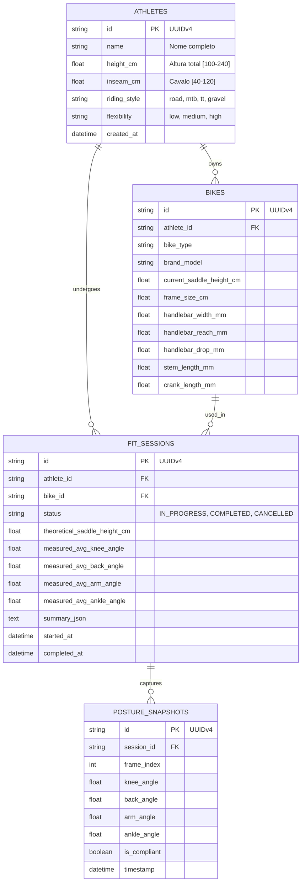

# Arquitetura do Sistema / System Architecture

> **Projeto:** Athlete Motion  
> **Versão Arquitetural:** `0.2.0`  
> **Padrão Arquitetural:** Clean Architecture / Hexagonal (Ports & Adapters)  
> **Língua Mãe:** Português (PT) | **Secondary:** English (EN)  

---

## 1. Visão Geral da Arquitetura / System Overview

O **Athlete Motion** é um ecossistema de software concebido para análise biomecânica e postural de ciclistas (*BikeFit*), operando em tempo real na Web para **computadores, telemóveis e tablets**.

A arquitetura adota a **Clean Architecture** (Arquitetura Limpa), dividida em 4 camadas concêntricas onde a regra de dependência aponta exclusivamente para o centro (o Domínio não depende de bibliotecas externas, frameworks web ou motores de persistência).

```
                      +---------------------------------------------------+
                      |               Presentation Layer                  |
                      |  - Vue 3 SPA (Composition API / Options API)      |
                      |  - Mobile / Desktop Responsive Viewport           |
                      |  - FastAPI REST Endpoints (/api/v1/...)           |
                      +-------------------------+-------------------------+
                                                |
                      +-------------------------v-------------------------+
                      |               Application Layer                   |
                      |  - Pydantic v2 DTOs (FitSession, Athlete, Bike)   |
                      |  - Orchestrators: Onboarding -> Live -> Report    |
                      +-------------------------+-------------------------+
                                                         +-------------------------v-------------------------+
                      |                 Domain Layer                      |
                      |  - calculator.py: Funções matemáticas puras       |
                      |  - biomechanics/: thresholds, fitting, posture,   |
                      |    alignment, symmetry, diagnostics (<150 linhas) |
                      |  - BiomechanicThresholds: Road, MTB, TT, Gravel   |
                      +-------------------------+-------------------------+
                                                ^
                      +-------------------------|-------------------------+
                      |             Infrastructure Layer                  |
                      |  - SQLite WAL Database (ACID Compliance)          |
                      |  - Unit of Work (uow.py) Transaction Manager      |
                      |  - MediaPipe Pose (WebAssembly & OpenCV)          |
                      |  - Web Audio API Ergonomic Feedback Engine        |
                      +---------------------------------------------------+
```

---

## 2. Camadas do Sistema / Detailed Layers

### 2.1. Camada de Domínio (`src/domain/`)
- **Independência Estrita:** Zero importações de frameworks (sem FastAPI, sem SQLAlchemy, sem Vue).
- **Submódulos:**
  - [`calculator.py`](file:///d:/Projects/athleteMotion/src/domain/calculator.py):
    - `calculate_safe_angle(a, b, c)`: Cálculo de ângulo no vértice B usando produto escalar e magnitudes, com clamping estrito do cosseno entre $[-1.0, 1.0]$ para impedir `NaN` por imprecisão de ponto flutuante e retorno seguro de `0.0` para vetores coincidentes.
    - `calculate_inclination_angle(bottom, top)`: Inclinação angular face à horizontal.
  - Pacote Modular [`src/domain/biomechanics/`](file:///d:/Projects/athleteMotion/src/domain/biomechanics/):
    - Submódulos desacoplados de alta legibilidade (< 150 linhas cada):
      - `thresholds.py`: Enums (`RidingStyle`, `FlexibilityLevel`) e matriz ergonómica `BIOMECHANIC_THRESHOLDS`.
      - `fitting.py`: Fórmulas canónicas de ajuste (LeMond $Cavalo \times 0.883$, Hamley 109%, tamanho de quadro, crenques, guiador).
      - `posture.py`: Avaliação sagital angular de joelho, tronco e cotovelo com deltas quantificados de ajuste.
      - `alignment.py`: Avaliação horizontal KOPS e desvio frontal de joelho (Varo/Valgo).
      - `symmetry.py`: Cálculo do Índice de Simetria Bilateral (SI) entre membros inferiores.
      - `diagnostics.py`: Avaliação de desnível vertical selim-guiador (Saddle Drop) e orquestração.
      - `__init__.py`: Re-exportação limpa de todos os símbolos para retrocompatibilidade 100%.

### 2.2. Camada de Infraestrutura e Persistência ACID (`src/infrastructure/`)
- **Conformidade ACID no SQLite:**
  - Configurado com **Write-Ahead Logging (WAL)**: permite leituras simultâneas sem bloqueio de escritores.
  - `PRAGMA foreign_keys = ON;`: Integridade referencial obrigatória entre ciclistas, bicicletas, sessões e snapshots.
  - `PRAGMA synchronous = NORMAL;`: Durabilidade comprovada em disco.
- **Padrão Unit of Work ([`uow.py`](file:///d:/Projects/athleteMotion/src/infrastructure/uow.py)):**
  - Todas as mutações de dados residem no gerenciador de contexto `with unit_of_work() as session:`.
  - Garante **Atomicidade**: se ocorrer qualquer exceção no cálculo de médias ou gravação de snapshots, a transação reverte (`rollback`) integralmente.



### 2.3. Camada de Apresentação e API REST (`server.py` e `src/api/v1/`)
- API FastAPI totalmente assíncrona e desacoplada.
- Schemas Pydantic v2 estritos com validação de limites de borda.
- Middleware de CORS flexível permitindo conexões de rede local para dispositivos móveis (`192.168.x.x`, `10.x.x.x`).
- Endpoint `/process_frame` blindado contra DoS: limite estrito de 5 MB, validação de magic bytes (JPEG/PNG/WebP) e decodificação segura OpenCV.

### 2.4. Frontend SPA Responsivo Multi-Dispositivo (`frontend/mediapipe/`)
- Fluxo de trabalho linear em 3 etapas modulares:
  1. [`AthleteOnboarding.vue`](file:///d:/Projects/athleteMotion/frontend/mediapipe/src/components/AthleteOnboarding.vue): Recolha primária de dados corporais e mecânicos com estimativa teórica em tempo real.
  2. [`LiveCameraCapture.vue`](file:///d:/Projects/athleteMotion/frontend/mediapipe/src/components/LiveCameraCapture.vue): Captura por câmara (PC webcam ou câmara traseira de smartphone via `MediaDevices`), MediaPipe Pose em tempo real, visualização em Canvas HTML5, HUD de ângulos, alertas sonoros e paragem limpa de hardware em `beforeUnmount()`.
  3. [`FitReportView.vue`](file:///d:/Projects/athleteMotion/frontend/mediapipe/src/components/FitReportView.vue): Relatório final consolidado, checklist de intervenções físicas na bicicleta e suporte a impressão/PDF.

---

## 3. Modelo de Processamento Híbrido (Edge vs Cloud)

Para obter a melhor performance em telemóveis e computadores:
* **Edge Processing (Browser / WebAssembly):** A inferência da pose corre localmente no navegador a **30-60 FPS**. Isso garante que o ciclista veja o esqueleto e os ângulos sem qualquer atraso de rede.
* **Server Processing (FastAPI / ACID):** O backend armazena o histórico do ciclista, gere as transações ACID das sessões, grava amostras consolidadas (snapshots) e compila os relatórios finais.

---

## 4. Gestão de Versão e CI/CD

- **SSOT:** Ficheiro [`VERSION`](file:///d:/Projects/athleteMotion/VERSION).
- **SemVer 2.0.0:** Incrementos automáticos baseados em Conventional Commits:
  - `#major` ou `BREAKING CHANGE:` $\rightarrow$ **Major** (`x.0.0`)
  - `#minor` ou `feat:` $\rightarrow$ **Minor** (`0.x.0`)
  - `fix:`, `refactor:`, `perf:` $\rightarrow$ **Patch** (`0.0.x`)
- **Git Hooks:** [`scripts/install_hooks.py`](file:///d:/Projects/athleteMotion/scripts/install_hooks.py) configura o hook `pre-push` localmente.
- **GitHub Actions:** Workflow [`.github/workflows/release.yml`](file:///d:/Projects/athleteMotion/.github/workflows/release.yml) gera tags automáticas e releases.
