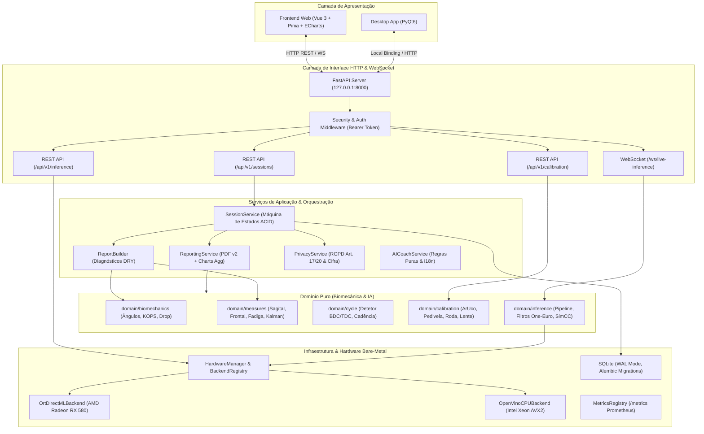
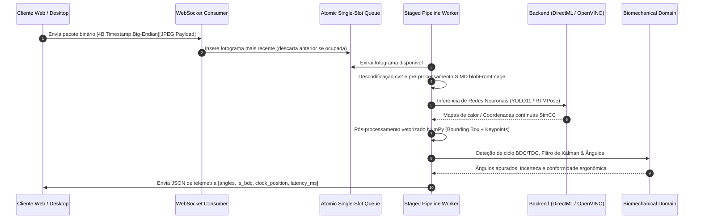
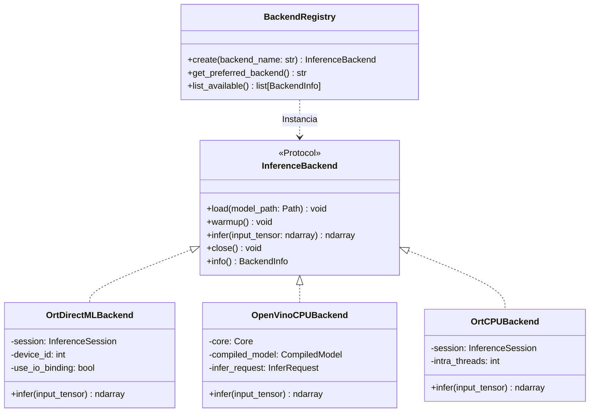
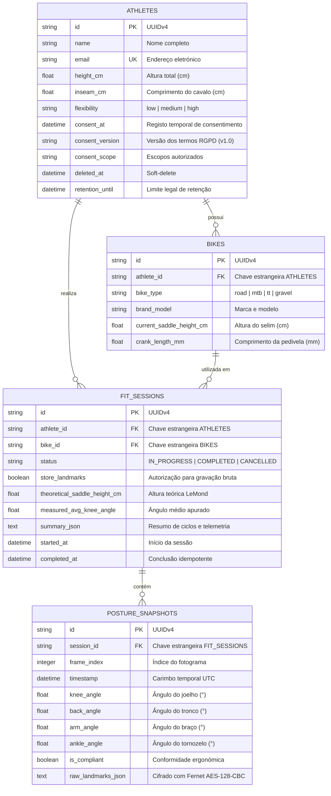

# Arquitetura Global do Sistema — Athlete Motion

> **Status:** 🟢 VIGENTE · **Versão:** 0.3.1 · **Última atualização:** 2026-10-14 · **Responsável:** Senior Core Developer · **Revisto contra o código em:** `788dcbb`
> **Referência:** R01, R03, R07, R08, R10, R11, R12, R14, R16, R17 · **Protocolo:** [00_PROTOCOLO_LLM.md](../TASKS/REVIEW_2026/00_PROTOCOLO_LLM.md)

---

## 1. Visão Geral e Princípios Arquiteturais

O **Athlete Motion** é uma plataforma profissional de análise biomecânica e BikeFit computacional em tempo real. A sua arquitetura segue os princípios estritos de engenharia estabelecidos em `AGENTS.md`:

1. **Separação Rígida de Responsabilidades (SoC):**
   - **Domínio Puro (`athletemotion.domain`):** Isento de dependências de frameworks (sem FastAPI, sem SQLAlchemy, sem PyQt6). Implementa a física de ângulos, cinemática de ciclos (BDC/TDC), calibração métrica espacial e métricas ergonómicas.
   - **Infraestrutura (`athletemotion.infrastructure`):** Conecta o domínio ao hardware e persistência (backends DirectML/OpenVINO, base de dados SQLite WAL com Alembic, métricas Prometheus e autotune).
   - **Serviços de Aplicação (`athletemotion.services`):** Orquestra sessões transacionais, pipeline de relatórios PDF auditáveis, conformidade RGPD e pareceres determinísticos do AI Coach.
   - **Camada de Apresentação (`athletemotion.api` & `frontend/` & `desktopapp/`):** Clientes Web Vue 3 / Pinia e Desktop PyQt6 atuam exclusivamente como cascas finas de apresentação e recolha de entrada.
2. **Propriedades ACID e Integridade:** Todas as mutações de dados na base de dados SQLite ocorrem sob transações atómicas com Write-Ahead Logging (WAL) e integridade referencial ativa.
3. **Desempenho Bare-Metal e Zero Placebos:** Aproveitamento nativo do hardware do host Windows (aceleração DirectML na AMD Radeon RX 580 e OpenVINO AVX2 no Intel Xeon E5-1660 v3). Nenhum número ou diagnóstico clínico é falsificado ou aproximado quando faltam dados confiáveis.

---

## 2. Diagrama de Arquitetura em Camadas

---

## 3. Pipeline de Inferência em Tempo Real e WebSocket

A comunicação de vídeo para inferência biomecânica em tempo real utiliza um protocolo binário otimizado sobre WebSocket com filas atómicas desacopladas (*latest-frame-wins*):

---

## 4. Estratégia de Backends e Aceleração de Hardware

O subsistema de aceleração de hardware desacopla totalmente a rede neuronal do runtime de inferência através do protocolo `InferenceBackend`:

### Decisões Operacionais de Hardware:
1. **Primary GPU (DirectML):** AMD Radeon RX 580 (Polaris 20, 8 GB VRAM) processa `yolo11n-pose-320` em **4.12 ms** (241 FPS) e `rtmpose-m` em **8.20 ms** (119 FPS).
2. **CPU Fallback (OpenVINO):** Intel Xeon E5-1660 v3 utiliza OpenVINO 2026.4.1 com instruções AVX2 e `PERFORMANCE_HINT=LATENCY`, atingindo **12.04 ms** com `rtmpose-m`.
3. **Rejeição Técnica de Quantização INT8:** Em Haswell-E (sem suporte de hardware para VNNI), o INT8 emulado é 2.2× mais lento que FP32 (`VFMADD213PS`). O sistema opera estritamente em **FP32 nativo**.

---

## 5. Modelo Relacional e Conformidade com Privacidade (RGPD)

---

## 6. Rastreabilidade Científica e Relatório PDF Auditável

O relatório técnico oficial em PDF (`athletemotion.services.reporting.pdf`) é gerado deterministicamente e contém:
- **Badge de Proveniência:** App version, Git SHA do commit, hash SHA-256 dos pesos do modelo, backend de execução e contagem de ciclos analisados.
- **Incerteza Propagada:** Toda a métrica exibe o valor médio $\pm$ incerteza combinada (ex.: $148.5^\circ \pm 1.2^\circ$) e score percentual de confiança.
- **Portão de Medidas Retidas (*Withheld*):** Quando a confiança do tracking é inferior a $0.60$ ou falta calibração espacial física, a medição é suprimida do diagnóstico com explicação clara do motivo clínico.
- **Visualizações Biomecânicas:** Curvas de revolução normalizadas (0–100%) com intervalo de $\pm 1\text{ DP}$ e distribuição de BDC geradas via Matplotlib sem estado global (`FigureCanvasAgg`).
