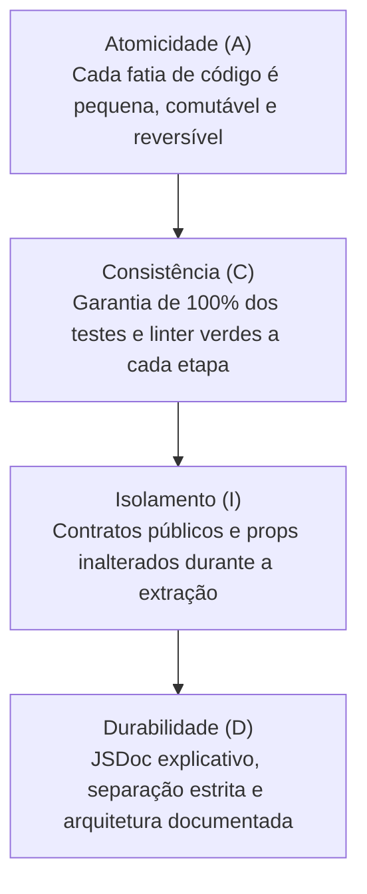

# [ARQUIVO HISTÓRICO] Plano de Refatoração do Frontend — Boas Práticas ACID & Responsabilidade Única

> **Aviso de Arquivo:** Este plano preliminar de refatoração foi executado e concluído na íntegra através das tarefas R16 e R01 em [TASKS/REVIEW_2026/](../TASKS/REVIEW_2026/).  
> **Data de Arquivo:** 2026-10-14  

---

## 1. Princípios Norteadores de Engenharia (A Abordagem ACID)

Para que a refatoração ocorra sem introduzir regressões ou instabilidade no ambiente de produção, todas as fatias de trabalho devem obedecer aos princípios fundamentais adaptados ao ciclo de vida do software:



1. **A — Atomicidade (Atomicity):**
   - Nenhuma refatoração altera mais de um domínio ou componente ao mesmo tempo.
   - Cada fatia é autocontida e comitável isoladamente. Se um teste falhar, o rollback é trivial e não contamina o repositório.
2. **C — Consistência (Consistency):**
   - **Rede de Segurança Obrigatória:** Antes de considerar qualquer fatia concluída, a execução de todos os testes é mandatória:
     - `npm run lint -- --no-fix` (0 erros e 0 avisos)
     - `npm run verify` (12 suites completas aprovadas no frontend)
     - `npm run build` (Build do bundle Webpack de produção íntegro)
     - `python -m pytest` (20/20 testes de backend aprovados)
3. **I — Isolamento (Isolation):**
   - Os contratos públicos de componentes (`props`, `emits`), nomes de rotas e chaves de armazenamento local (`localStorage`, `IndexedDB`) permanecem idênticos.
   - A extração interna não mexe na regra de negócio; apenas reorganiza a responsabilidade do código.
4. **D — Durabilidade (Durability):**
   - Fim dos "God Objects": **Limite estrito de 150 a 250 linhas por arquivo**.
   - Código autoexplicativo com documentação JSDoc em Português e tipagens claras, permitindo que qualquer desenvolvedor júnior compreenda o fluxo imediatamente.

---

## 2. Diagnóstico Técnico do Frontend (Onde Dói)

### 2.1. Inventário de Arquivos Gigantes (Métricas Reais)

A análise detalhada da árvore `frontend/mediapipe/src/` revelou uma concentração desproporcional de lógica e marcação no ecossistema de captura e análise:

| Arquivo | Linhas | Domínio | Diagnóstico Técnico |
|---|:---:|---|---|
| `components/LiveCameraCapture/LiveCameraCapture.js` | **3.354** | Orquestração Geral | **Crítico:** Acumula 14 responsabilidades distintas (câmara, scrubber, galeria, pipeline, scan de vídeo, órbita do pé, perfis, relatórios). Impossível de manter sem risco de efeitos colaterais. |
| `components/LiveCameraCapture/styles/video-analysis.css` | **3.113** | Folha de Estilos | **Crítico:** Folha monolítica com estilos de modais, galerias, barras de scrub, cartões de fase e tabelas condensados num só arquivo. |
| `components/LiveCameraCapture/LiveCameraCapture.html` | **2.109** | Template HTML | **Crítico:** Template gigantesco contendo o viewport principal + 7 modais flutuantes + 4 painéis de diagnóstico no mesmo arquivo. |
| `modules/videoUploadManager.js` | **850** | Upload & Leitura | **Alto:** Mistura lógica de drag-and-drop, carregamento de blobs, indexação de duração de vídeo e cálculo de FPS. |
| `modules/coherentRecommendationEngine.js` | **803** | Motor Biomecânico | **Médio:** Reconciliação angular e geração textual de prescrições agrupadas num único módulo extenso. |
| `modules/finalPrescriptionEngine.js` | **779** | Prescrição de Vídeo | **Médio:** Agregação estatística, interpolação temporal e prescrição ergonómica condensadas. |
| `modules/canvasOverlayRenderer.js` | **632** | Desenho Canvas 2D | **Médio:** Desenho de esqueleto, arcos angulares, linha de prumo, guias de alinhamento e HUD misturados. |
| `i18n.js` | **616** | Internacionalização | **Baixo:** Dicionários em Português e Inglês no mesmo arquivo em vez de isolados por idioma. |
| `modules/footOrbitTrace.js` | **614** | Geometria Orbital | **Médio:** Cálculo vetorial, ajuste de círculo em píxeis e renderização da órbita no canvas no mesmo arquivo. |
| `modules/technicalSummary.js` | **596** | Contabilidade de Dados | **Médio:** Regras de contabilidade de dados e formatação tabular no mesmo módulo. |
| `LiveCameraCapture.css` | **589** | Estilos Base | **Médio:** Estilos gerais da câmara acumulados. |
| `modules/positionOptimization.js` | **551** | Avaliação por Fase | **Médio:** Regras para as 4 fases da pedaleira (12h, 3h, 6h, 9h) num único arquivo. |
| `modules/liveTuningReportManager.js` | **536** | Relatório ao Vivo | **Médio:** Gestão de amostras em tempo real e montagem de relatório clínico acopladas. |

---

## 3. Arquitetura Alvo: Desacoplamento & Component-as-a-Folder

### 3.1. Padrão Component-as-a-Folder (Regra de Ouro)

Todo componente Vue deve residir na sua própria pasta e seguir a separação estrita de responsabilidades:
1. `[Nome].vue`: Shim orquestrador mínimo (3 linhas).
2. `[Nome].html`: Template puramente semântico.
3. `[Nome].js`: Estado reativo e interação com o DOM (< 150–200 linhas).
4. `[Nome].css`: Folha de estilo isolada/scoped (< 150 linhas).
5. `index.js`: Ponto de exportação limpo para a aplicação.

```
components/LiveCameraCapture/
├── LiveCameraCapture.vue             (Orquestrador raiz magro ~ 3 linhas)
├── LiveCameraCapture.html            (Layout base e slots ~ 150 linhas)
├── LiveCameraCapture.js              (Coordenação principal ~ 180 linhas)
├── LiveCameraCapture.css             (Estilos base do layout ~ 120 linhas)
│
├── components/                       (Subcomponentes especializados didáticos)
│   ├── VideoPlayerViewport/          (Canvas de vídeo, overlay 2D e cursor)
│   ├── VideoScrubberBar/             (Barra de jog-shuttle, velocidade e botões A-B)
│   ├── CameraHudHeader/              (Status, seleção de câmara, flip e resolução)
│   ├── PhotoGalleryModal/            (Galeria multi-foto e seletor 12h/3h/6h/9h)
│   ├── ChromaTrackPanel/             (Controlo de marcadores HSV e diagnósticos)
│   ├── BilateralWizardModal/         (Assistente guiado de troca bilateral)
│   ├── AthleteProfileModal/          (Modal de dados do ciclista e cleats)
│   ├── AnglesTimelinePanel/          (Gráfico interativo das 4 curvas articulares)
│   ├── FootOrbitPanel/               (Visualização e métricas da dinâmica do pé)
│   ├── VideoScanProgressModal/       (Progresso do varrimento integral de vídeo)
│   ├── PrescriptionReportModal/      (Relatório final unificado com afinações)
│   ├── TechnicalSummaryDrawer/       (Gaveta de auditoria de dados do ciclista)
│   └── DebugLogDrawer/               (Consola lateral de diagnósticos)
│
└── composables/                      (Lógica reativa reutilizável e desacoplada)
    ├── useCameraStream.js            (Captura WebCam e gestão de streams)
    ├── useVideoPlayback.js           (Play/pause, scrub, marcha-atrás e loop A-B)
    ├── usePoseTracking.js            (Orquestração do modelo MediaPipe)
    ├── usePhotoGallery.js            (Armazenamento e estado das fotos)
    ├── useFullVideoScan.js           (Coordenação do varrimento em 2 passagens)
    ├── useAthleteProfile.js          (Persistência e validação do ciclista)
    └── usePrescriptionReports.js     (Formatação e partilha de relatórios)
```

---

## 4. Plano Operacional de Refatoração em 10 Fatias Atómicas (Slices)

Cada fatia foi projetada para ser executada de forma **atómica, independente e verificável**.

```mermaid
gantt
    title Cronograma de Fatias Atómicas de Refatoração
    dateFormat  X
    axisFormat  Fatia %s
    section Decomposição de Componentes
    Fatia 1 (Scrubber & Timeline)      :active, 1, 2
    Fatia 2 (Perfis & Onboarding)       :2, 3
    Fatia 3 (ChromaTrack & Diagnósticos):3, 4
    Fatia 4 (Galeria de Fotos)          :4, 5
    Fatia 5 (Gráfico de Ângulos)        :5, 6
    Fatia 6 (Dinâmica do Pé e Órbita)   :6, 7
    Fatia 7 (Relatórios & Prescrição)   :7, 8
    Fatia 8 (Scan Integral de Vídeo)    :8, 9
    section Modularização de Domínio
    Fatia 9 (Motores Biomecânicos)      :9, 10
    Fatia 10 (Renderers Canvas & i18n)  :10, 11
```



---

### Fatia 1: Extração da Barra de Reprodução e Scrubber (`VideoScrubberBar`) — [x] CONCLUÍDA
* **Status:** ✅ **Concluída com Sucesso** (Fatia 1 implementada e validada segundo os princípios ACID).
* **Componente Criado:** `frontend/mediapipe/src/components/LiveCameraCapture/components/VideoScrubberBar/`
  - `VideoScrubberBar.vue` (Shim Component-as-a-Folder)
  - `VideoScrubberBar.html` (Template dedicado de 435 linhas extraído do monolito)
  - `VideoScrubberBar.js` (Componente de 160 linhas desacoplado com props e emits limpos)
  - `VideoScrubberBar.css` (Estilos isolados importando `@import '../../styles/video-analysis.css';`)
  - `index.js` (Exportação limpa)
* **Impacto no Monolito:**
  - `LiveCameraCapture.html`: Redução de 2337 para 1951 linhas (-386 linhas).
  - `LiveCameraCapture.js`: Registado e integrado com resolução de ref resiliente e delegação de eventos.
* **Validação ACID (100% Green):**
  - `npm run lint -- --no-fix`: 0 erros.
  - `npm run verify`: 12 suites completas aprovadas (playback, scrubber, chroma, profiles, theme, etc.).
  - `npm run build`: Bundle Webpack de produção compilado com sucesso.
  - `python -m pytest`: 20/20 testes de backend aprovados.

---

### Fatia 2: Extração do Modal de Perfil do Ciclista (`AthleteProfileModal`)
* **Problema Atual:** Modal de edição de peso, número de calçado, cintura, altura, costura e posição dos travessões consome ~180 linhas de métodos de storage em `LiveCameraCapture.js` e ~120 linhas de HTML.
* **Ação Atómica:**
  1. Criar `components/LiveCameraCapture/components/AthleteProfileModal/`.
  2. Mover o formulário e a validação para o novo componente.
  3. Criar composable `composables/useAthleteProfile.js` (< 110 linhas) com persistência limpa em `localStorage`.
* **Contrato (Props / Emits):**
  - Props: `visible`, `profile`.
  - Emits: `close`, `save`, `clear`.
* **Critério de Aceitação ACID:** `npm run verify:profiles` e `npm run lint` 100% verdes.

---

### Fatia 3: Isolamento do Módulo CromaTrack e Gaveta de Logs (`ChromaTrackPanel` & `DebugLogDrawer`)
* **Problema Atual:** Controles de saturação/matiz, botões de paleta e drawer de logs poluem o cabeçalho e rodapé do template principal.
* **Ação Atómica:**
  1. Criar `ChromaTrackPanel` isolando os controlos de marcadores e diagnóstico de blobs.
  2. Criar `DebugLogDrawer` isolando a listagem de mensagens de depuração de baixa latência.
* **Contrato (Props / Emits):**
  - Props: `chromaEnabled`, `chromaStats`, `logs`.
  - Emits: `toggle-chroma`, `set-palette-mode`, `clear-logs`.
* **Critério de Aceitação ACID:** `npm run verify:chroma` e `npm run lint` 100% verdes.

---

### Fatia 4: Extração da Galeria Multi-Fotos (`PhotoGalleryModal`)
* **Problema Atual:** O carrossel de fotos, seleção manual de fase (12h, 3h, 6h, 9h), re-análise e remoção ocupam ~300 linhas de HTML e métodos espalhados em `LiveCameraCapture.js`.
* **Ação Atómica:**
  1. Criar `components/LiveCameraCapture/components/PhotoGalleryModal/`.
  2. Transferir a grelha de miniaturas, os badges de fase e os botões de ação para o subcomponente.
  3. Criar `composables/usePhotoGallery.js` com os métodos puros de gestão de itens.
* **Contrato (Props / Emits):**
  - Props: `visible`, `photos`, `selectedPhotoId`.
  - Emits: `close`, `select-photo`, `analyze-photo`, `remove-photo`, `set-crank-position`.
* **Critério de Aceitação ACID:** `npm run verify:positions` e `npm run lint` 100% verdes.

---

### Fatia 5: Isolamento do Painel de Gráfico Temporal (`AnglesTimelinePanel`)
* **Problema Atual:** Renderização do canvas de ângulos, clique para navegação temporal e legenda de cores ocupam métodos diretos no componente raiz.
* **Ação Atómica:**
  1. Criar `components/LiveCameraCapture/components/AnglesTimelinePanel/`.
  2. Encapsular a gestão do canvas e o redimensionamento dinâmico.
  3. Ligar diretamente a `AnglesTimelineChart.render` sem acoplamento a variáveis externas.
* **Contrato (Props / Emits):**
  - Props: `samples`, `currentTime`, `duration`, `targets`, `loopRange`.
  - Emits: `time-selected`.
* **Critério de Aceitação ACID:** `npm run verify:full-analysis` e `npm run lint` 100% verdes.

---

### Fatia 6: Extração da Dinâmica do Pé e Órbita da Pedaleira (`FootOrbitPanel`)
* **Problema Atual:** Cartões comparativos das voltas, diâmetro orbital, sentido de rotação e hora aproximada do pé poluem o relatório de análise de vídeo.
* **Ação Atómica:**
  1. Criar `components/LiveCameraCapture/components/FootOrbitPanel/`.
  2. Agrupar as cartas métricas da pedaleira e o seletor ligar/desligar da órbita.
* **Contrato (Props / Emits):**
  - Props: `orbitSummary`, `footPositionText`, `showOrbit`.
  - Emits: `toggle-orbit`.
* **Critério de Aceitação ACID:** `npm run verify:full-analysis` e `npm run lint` 100% verdes.

---

### Fatia 7: Extração dos Modais de Prescrição e Resumo Técnico
* **Problema Atual:** Os modais de afinações em direto (`activeTuningReport`), prescrição final do vídeo (`videoFinalPrescription`) e resumo técnico de dados (`technicalSummaryRows`) somam mais de 700 linhas de template.
* **Ação Atómica:**
  1. Criar `PrescriptionReportModal/` (apresentação clínica de afinações e prioridades).
  2. Criar `TechnicalSummaryDrawer/` (gaveta de auditoria de dados fornecidos e seu efeito mecânico).
* **Contrato (Props / Emits):**
  - Props: `visible`, `report`, `technicalAccounting`.
  - Emits: `close`, `copy-report`.
* **Critério de Aceitação ACID:** `npm run verify:coherence` e `npm run verify:equipment` 100% verdes.

---

### Fatia 8: Extração do Modal de Progresso do Scan (`VideoScanProgressModal`)
* **Problema Atual:** O anel de progresso percentual, contador de fotogramas e status das duas passagens (reconhecimento e refinação) residem no markup central.
* **Ação Atómica:**
  1. Criar `VideoScanProgressModal/` com barra de progresso e botões de cancelamento.
* **Contrato (Props / Emits):**
  - Props: `running`, `progress`.
  - Emits: `cancel`.
* **Critério de Aceitação ACID:** `npm run verify:full-analysis` e `npm run lint` 100% verdes.

---

### Fatia 9: Modularização dos Motores Biomecânicos de Domínio
* **Problema Atual:** `coherentRecommendationEngine.js` (803 linhas) e `finalPrescriptionEngine.js` (779 linhas) misturam reconciliação matemática com formatação de relatórios em texto.
* **Ação Atómica:**
  1. Decompor `coherentRecommendationEngine/` em:
     - `reconciler.js` (< 110 linhas — funções puras de reconciliação de votos com sinal).
     - `saddleResolvers.js` (< 130 linhas — resolução de altura e recuo de selim).
     - `cockpitResolvers.js` (< 130 linhas — resolução de stack e reach).
     - `ankleResolvers.js` (< 120 linhas — resolução de tornozelo e travessões).
     - `textFormatter.js` (< 130 linhas — geração textual para impressão).
  2. Decompor `finalPrescriptionEngine/` em submódulos de cálculo estatístico de medianas e agregação ergonómica.
* **Critério de Aceitação ACID:** `npm run verify:coherence`, `verify:equipment`, `verify:positions` e `verify:estimates` 100% verdes.

---

### Fatia 10: Desacoplamento do Overlay Canvas 2D e Separação de Idiomas do i18n
* **Problema Atual:**
  - `canvasOverlayRenderer.js` (632 linhas) acumula todo o desenho do esqueleto, guias fantasma e HUD.
  - `i18n.js` (616 linhas) junta português e inglês no mesmo arquivo.
* **Ação Atómica:**
  1. Decompor `canvasOverlayRenderer` em:
     - `skeletonRenderer.js` (< 120 linhas)
     - `anglesRenderer.js` (< 130 linhas)
     - `guidesRenderer.js` (< 100 linhas)
  2. Dividir `i18n.js` em:
     - `locales/pt.js` (< 300 linhas)
     - `locales/en.js` (< 300 linhas)
     - `index.js` (< 60 linhas)
* **Critério de Aceitação ACID:** Execução de todas as 12 suites com `npm run verify` e `npm run lint`.

---

## 5. Matriz de Rastreabilidade e Validação de Sucesso

| Métrica de Qualidade | Estado Atual (Legado) | Estado Alvo (Pós-Refatoração) | Ganho de Engenharia |
|---|:---:|:---:|---|
| **Maior arquivo do frontend** | `LiveCameraCapture.js` (3.354 lin.) | Qualquer arquivo ≤ **200–250 linhas** | **-93% de complexidade por arquivo** |
| **Maior folha de estilos** | `video-analysis.css` (3.113 lin.) | Folhas isoladas ≤ **150 linhas** | Fim de colisões de seletores globais |
| **Maior template HTML** | `LiveCameraCapture.html` (2.109 lin.) | Componente raiz ≤ **180 linhas** | Leitura imediata da hierarquia DOM |
| **Suíte de Testes Automatizados** | 12/12 suites verdes | 12/12 suites verdes | **Zero regressão funcional** |
| **Conformidade com ESLint** | 0 erros / 0 avisos | 0 erros / 0 avisos | Padrão limpo contínuo |
| **Tempo de Onboarding de Juniores** | Dias / Semanas | Poucas Horas | Cada funcionalidade tem pasta própria |

---

## 6. Procedimento de Segurança Operacional (Safe-Playbook)

Antes de iniciar qualquer fatia, o desenvolvedor deve seguir rigorosamente o protocolo:

```bash
# 1. Garantir estado limpo e testes passando antes de tocar no código
npm run lint -- --no-fix
npm run verify
python -m pytest

# 2. Criar branch isolada para a fatia (exemplo: Fatia 1)
git checkout -b refactor/slice-01-video-scrubber

# 3. Executar a extração atómica sem alterar lógica funcional

# 4. Validar o contrato de consistência
npm run lint -- --no-fix
npm run verify
npm run build
python -m pytest

# 5. Comitar de forma atómica
git commit -m "refactor(frontend): decomposicao da barra de scrubber em componente dedicado"
```

Se qualquer verificação falhar:
```bash
# Rollback imediato garantindo a Atomicidade
git checkout -- .
```

---

*Documento aprovado segundo as melhores práticas de Engenharia de Software e Padrões de Arquitetura Limpa.*
