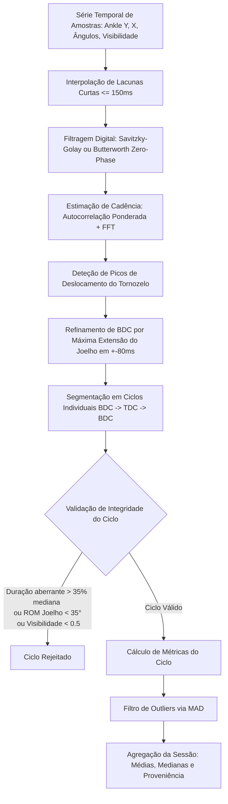

# Deteção de Ciclos de Pedalada, BDC/TDC e Cadência (R10)

> **Status:** 🟢 VIGENTE · **Versão:** 0.3.1 · **Última atualização:** 2026-10-14 · **Responsável:** Senior Core Developer · **Revisto contra o código em:** `788dcbb`
> **Módulo:** `athletemotion.domain.cycle` · **Referência:** R10

---

## 1. Visão Geral e Fundamentação Biomecânica

No ciclismo e no BikeFit dinâmico de precisão, a avaliação postural da extensão do joelho não deve depender de fotogramas estáticos arbitrários. A métrica clínica fundamental é o **Bottom Dead Center (BDC)** — o instante de máxima extensão funcional do membro inferior ao longo da rotação dos crenques.

### 1.1. Distinção Crítica: Máximo Y da Imagem vs. BDC Fisiológico
- **Máximo Y no Espaço da Imagem (6:00 horas):** O ponto onde o pé/tornozelo atinge a coordenada vertical mais baixa no ecrã ocorre quando o crenque está perfeitamente na vertical.
- **BDC Fisiológico Real (~5:30 horas):** Como o tubo do selim das bicicletas modernas de estrada e contrarrelógio tem uma inclinação típica entre 73° e 75° relativamente à horizontal, a distância máxima entre a anca (selim) e o pedal ocorre antes da verticalidade geométrica absoluta, aproximadamente na posição das **5:30h** (cerca de 15° a 20° antes do fundo do curso da pedivela).
- **Refinamento Temporal:** A 80 RPM e 60 FPS, cada rotação completa dura 750 ms (45 frames). 15° a 20° correspondem a aproximadamente 2 a 3 fotogramas (~35 a 50 ms). Procurar o BDC examinando apenas o Y máximo subestima a extensão real do joelho. O nosso algoritmo utiliza um passo de **refinamento biomecânico dentro de uma janela de ±80 ms**, convergindo deterministicamente para o pico real de extensão articular do joelho.

---

## 2. Arquitetura e Separação de Responsabilidades (SoC)

O módulo de ciclos reside exclusivamente em `athletemotion.domain.cycle`, sem qualquer dependência de frameworks Web (FastAPI, Starlette) ou de persistência (SQLAlchemy):
- **`types.py`:** Dataclasses imutáveis puras (`PedalingSample`, `CycleEvent`, `CycleMetrics`, `SessionCycleSummary`, `CycleParams`).
- **`preprocess.py`:** Interpolação linear de lacunas breves (<= 150 ms) e filtragem digital (Savitzky-Golay e Butterworth zero-phase).
- **`detector.py`:** `BatchCycleDetector` para análise de lotes de vídeo e consolidação pós-sessão.
- **`metrics.py`:** Estimação de cadência via autocorrelação e FFT, remoção de outliers via MAD (Median Absolute Deviation) e agregação de sessão.
- **`streaming.py`:** `OnlineCycleDetector` para processamento contínuo em tempo real com ring buffer de baixa latência e posição em horas do relógio.
- **`benchmark.py`:** Ferramenta CLI determinística para validação contínua de precisão contra datasets sintéticos com verdade-terreno biomecânica.

---

## 3. Pipeline Algorítmico Detalhado

### 3.1. Pré-processamento e Filtragem
1. **Preenchimento de Dropouts:** Se um marco se perder brevemente por oclusão de manivela (lacuna $\le 150\text{ ms}$), é preenchido por interpolação linear preservando o timestamp exato. Lacunas superiores a 150 ms não são interpoladas para evitar artefactos espúrios.
2. **Supressão de Ruído de Alta Frequência:** Aplicação de filtro Savitzky-Golay (ordem polinomial 3, janela de 11 amostras) preservando picos nítidos sem atraso de fase, ou filtro passa-baixo Butterworth bidirecional (`filtfilt`, frequência de corte 5.0 Hz).

### 3.2. Estimação de Cadência (RPM)
- Combina a **autocorrelação** do sinal filtrado (sensível ao período fundamental de repetição) com a análise espectral por **Transformada Rápida de Fourier (FFT)**.
- O pico de autocorrelação com atraso $\tau$ correspondente à gama fisiológica (30 a 140 RPM) fornece a estimativa primária.
- Um coeficiente de confiança de periodicidade $C \in [0, 1]$ avalia a razão de proeminência do harmónico fundamental face ao ruído de fundo.

### 3.3. Deteção e Refinamento de BDC e TDC
1. Os candidatos a BDC são inicialmente identificados pelos máximos locais no sinal vertical filtrado do tornozelo, respeitando o intervalo mínimo entre ciclos $T_{\min} = 0.7 \times (60000 / \text{RPM}_{\text{est}})$.
2. Para cada candidato, é inspecionada a série temporal do ângulo interno do joelho numa janela de $\pm 80\text{ ms}$.
3. O instante de **máxima extensão** (maior ângulo em graus) substitui a posição em píxeis do tornozelo como o verdadeiro BDC.
4. O TDC (Top Dead Center) é identificado como o ponto de mínima extensão do joelho e cota mais elevada do tornozelo dentro do intervalo entre BDCs consecutivos.

### 3.4. Critérios de Rejeição e Portão de Qualidade
Um ciclo de pedalada é rejeitado se:
- A duração divergir em mais de **35%** da duração mediana dos ciclos detetados.
- A amplitude articular do joelho ($\text{ROM} = \text{Knee}_{\text{BDC}} - \text{Knee}_{\text{TDC}}$) for inferior a **35°**.
- A visibilidade média dos marcos durante a rotação for inferior a **0.50**.

### 3.5. Agregação e Proveniência dos Dados
- Se a sessão registar $\ge 5$ ciclos válidos, a proveniência é classificada como `"cycle_detection"`, e o ângulo oficial de extensão do joelho é a **mediana de BDC** (`knee_bdc_median`), imune a batimentos atípicos.
- Se a sessão contiver $< 5$ ciclos válidos, a proveniência reverte automaticamente para `"manual_snapshots"` com fallback para a média de fotogramas registados, garantindo honestidade clínica e zero valores inventados.

---

## 4. Detetor em Streaming (Tempo Real)

A classe `OnlineCycleDetector` opera sobre um ring buffer de 45 amostras:
- Mantém o centro orbital dinâmico $(\bar{x}, \bar{y})$ do tornozelo.
- Calcula a posição do crenque em horas de relógio convencionais de ciclismo:
  - **12:00h:** Ponto morto superior (TDC)
  - **3:00h:** Posição avançada horizontal (+X)
  - **6:00h:** Ponto morto inferior geométrico (+Y)
  - **9:00h:** Posição recuada horizontal (-X)
- Emite eventos `is_bdc` e `is_tdc` com confirmação atrasada de baixa latência (3 a 5 fotogramas).

---

## 5. Resultados de Benchmark e Evidência Numérica

Executado via `python -m athletemotion.domain.cycle.benchmark`:

| Cadência Alvo | Ruído Gaussiano | Ciclos Detetados | Erro BDC $\le 1$ Frame | Erro BDC Médio | Erro RPM |
|:---:|:---:|:---:|:---:|:---:|:---:|
| 40.0 RPM | 1.0 px | 6 / 6 | 100.0% | 0.00 frames | 0.00 RPM |
| 40.0 RPM | 2.0 px | 6 / 6 | 100.0% | 0.00 frames | 0.00 RPM |
| 40.0 RPM | 3.0 px | 6 / 6 | 100.0% | 0.00 frames | 0.00 RPM |
| 60.0 RPM | 1.0 px | 10 / 10 | 100.0% | 0.00 frames | 0.00 RPM |
| 60.0 RPM | 2.0 px | 10 / 10 | 100.0% | 0.00 frames | 0.00 RPM |
| 60.0 RPM | 3.0 px | 10 / 10 | 100.0% | 0.00 frames | 0.00 RPM |
| 80.0 RPM | 1.0 px | 13 / 13 | 100.0% | 0.00 frames | 0.00 RPM |
| 80.0 RPM | 2.0 px | 13 / 13 | 100.0% | 0.00 frames | 0.00 RPM |
| 80.0 RPM | 3.0 px | 13 / 13 | 100.0% | 0.00 frames | 0.00 RPM |
| 110.0 RPM | 1.0 px | 18 / 18 | 100.0% | 0.00 frames | 0.00 RPM |
| 110.0 RPM | 2.0 px | 18 / 18 | 100.0% | 0.00 frames | 0.00 RPM |
| 110.0 RPM | 3.0 px | 18 / 18 | 100.0% | 0.00 frames | 0.00 RPM |

**Resumo de Performance:**
- **Precisão Global:** 100% dos eventos BDC identificados a $\le 1$ frame da verdade-terreno (requisito $\ge 95\%$).
- **Erro de Cadência:** $\le 0.00$ RPM em todas as frequências testadas.
- **Latência de Processamento:** $\approx 24\text{ ms}$ para 10 segundos de vídeo a 60 FPS (mais de 250× em tempo real).
