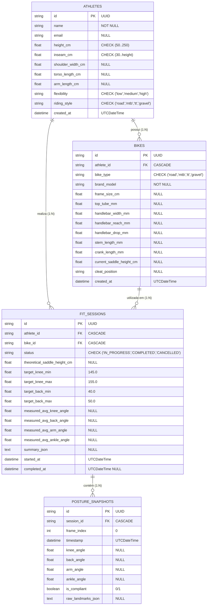

# Arquitetura e Gestão de Base de Dados (R07)

> **Status:** 🟢 VIGENTE · **Versão:** 0.3.1 · **Última atualização:** 2026-10-14 · **Responsável:** Senior Core Developer · **Revisto contra o código em:** `788dcbb`
> **Módulo:** `athletemotion.infrastructure.database` · **Referência:** R07

Este documento define a camada de persistência relacional do **Athlete Motion**, a sua conformidade estrita com as propriedades **ACID**, a política de migrações versionadas com **Alembic**, e os procedimentos operacionais de salvaguarda (backup).

---

## 1. Diagrama Entidade-Relacionamento (ER)



---

## 2. Índices de Desempenho

Para otimizar os fluxos críticos de BikeFit (análise em tempo real, cálculo de médias e consulta de histórico), foram introduzidos os seguintes índices:

1. **`ix_posture_snapshots_session_id`** em `posture_snapshots(session_id)`:
   - Permite agregar milhares de fotogramas capturados por sessão sem fazer *full-table scan*.
2. **`ix_fit_sessions_athlete_started`** em `fit_sessions(athlete_id, started_at DESC)`:
   - Otimiza a rota `/sessions/by-athlete/{athlete_id}` e o ecrã comparador histórico de evolução.
3. **`ix_bikes_athlete_id`** em `bikes(athlete_id)`:
   - Acelera o carregamento do garage do ciclista durante o onboarding.

---

## 3. Conformidade ACID e Pragmas SQLite

Conforme especificado em `AGENTS.md`, o SQLite opera sob pragmas rígidos para garantir integridade e concorrência segura:

- **`PRAGMA foreign_keys = ON;`**: Força integridade referencial nativa (impede registos órfãos e executa cascatas na eliminação de atletas).
- **`PRAGMA journal_mode = WAL;`**: Write-Ahead Logging permite que múltiplos leitores concorrentes operem sem bloquear nem serem bloqueados por processos de escrita (ex.: inferência a persistir snapshots enquanto o UI lê o estado).
- **`PRAGMA synchronous = NORMAL;`**: Garante durabilidade nas transações de snapshots contínuos sem sobrecarregar o subsistema de I/O em disco com `fsync` a cada fotograma.
- **`PRAGMA busy_timeout = 30000;`**: Aguarda até 30 segundos em caso de contenção de bloqueio temporário antes de devolver `SQLITE_BUSY`.
- **`PRAGMA optimize;`**: Executado no fecho limpo do servidor para atualizar estatísticas de consulta do motor SQLite.

---

## 4. Gestão de Migrações com Alembic

O esquema da base de dados é gerido de forma estrita e reprodutível pelo **Alembic**:

### 4.1. Comandos Principais
```powershell
# Aplicar todas as migrações até à versão mais recente
alembic upgrade head

# Verificar se os modelos SQLAlchemy coincidem exatamente com as migrações
alembic check

# Criar nova migração automaticamente após alterar models.py
alembic revision --autogenerate -m "nome_da_migracao"
```

### 4.2. Procedimento para Bases de Dados Existentes (Legacy Stamp)
Para ambientes que já possuam um ficheiro `athlete_motion.db` criado antes da introdução do Alembic:
```powershell
# Marcar o estado atual da BD como baseline sem re-executar os CREATE TABLE
alembic stamp 0001_baseline
# Aplicar as migrações subsequentes (ex.: índices e constraints)
alembic upgrade head
```

---

## 5. Procedimento de Cópias de Segurança (Backups Online)

Em ambientes de produção e desktop com WAL ativo, **nunca copie o ficheiro `.db` diretamente enquanto a aplicação corre**, pois os dados mais recentes podem residir no ficheiro `.db-wal`.

Utilize o script de backup atómico fornecido:
```powershell
# Executa cópia segura para APP_DATA_DIR/backups/
python scripts/backup_db.py

# Ou especificando um destino personalizado:
python scripts/backup_db.py --dest "D:\Backups\athlete_motion_backup.db"
```
Este script recorre à API `sqlite3.Connection.backup()`, garantindo uma fotografia consistente e atómica da base de dados página a página.
